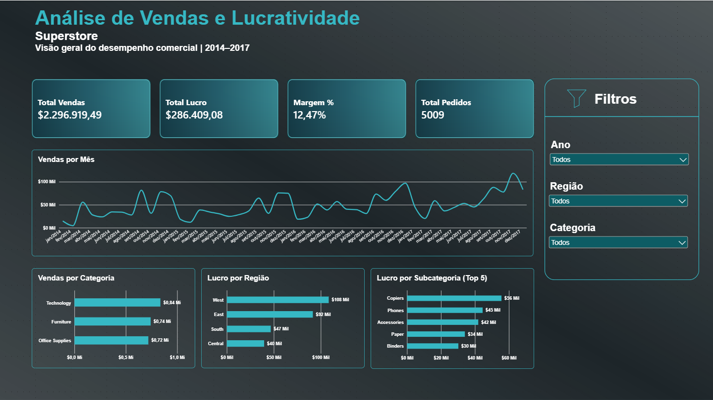

# Retail Sales & Profitability Analysis

## Sobre o projeto

Projeto de análise de dados desenvolvido com **SQL Server e Power BI**, utilizando a base Superstore para investigar o desempenho comercial e a rentabilidade de uma operação de varejo.

O trabalho contempla o tratamento e a validação dos dados com SQL, a análise de indicadores de negócio e a construção de um dashboard interativo para facilitar a exploração dos resultados.

## Objetivos da análise

- Avaliar o desempenho geral de vendas, lucro e margem.
- Comparar a rentabilidade entre categorias e subcategorias.
- Investigar a relação entre descontos e lucratividade.
- Analisar a evolução mensal das vendas e dos lucros.
- Comparar resultados entre regiões e segmentos de clientes.

## Base de dados

- **Fonte:** [Superstore Dataset — Kaggle](https://www.kaggle.com/datasets/vivek468/superstore-dataset-final)
- **Registros após tratamento:** 9.993
- **Pedidos distintos:** 5.009
- **Período analisado:** 2014 a 2017
- **Moeda dos valores:** dólar americano (USD)

## Ferramentas utilizadas

- **SQL Server:** armazenamento, tratamento, validação e consultas analíticas.
- **SQL:** limpeza, padronização e análise dos dados.
- **Power BI Desktop:** construção do dashboard e exploração visual dos indicadores.

## Etapas do projeto

1. **Importação dos dados:** carregamento da base original no SQL Server.
2. **Tratamento dos dados:** conversão de tipos, padronização de campos e remoção de registro duplicado.
3. **Validação:** verificações de qualidade e integridade da tabela tratada.
4. **Análise de negócio:** consultas SQL para investigar vendas, lucro, margens, descontos, períodos, regiões e segmentos.
5. **Visualização:** desenvolvimento de dashboard interativo no Power BI.
6. **Documentação:** registro dos principais resultados e insights identificados.

## Dashboard Power BI

**[Acesse o dashboard interativo no Power BI](https://app.powerbi.com/view?r=eyJrIjoiZTA1MjFhMDctMjA4My00ZmE2LWFmYjQtNTNjMGUyM2RjZmUxIiwidCI6IjMxYjM3MmU2LWE2ZWYtNGNiYS04YjM4LTUxMjVhMTEyMjBhNiJ9)**

O dashboard apresenta uma visão geral do desempenho comercial, com indicadores e gráficos interativos.



**Indicadores principais:**
- Total de vendas
- Total de lucro
- Margem de lucro
- Total de pedidos

**Análises visuais:**
- Evolução mensal das vendas
- Vendas por categoria
- Lucro por região
- Top 5 subcategorias por lucratividade

**Filtros interativos:** ano, região e categoria.

O arquivo do Power BI também está disponível para download: [powerbi/Retail-Sales-Profitability-Analysis.pbix](powerbi/Retail-Sales-Profitability-Analysis.pbix).

## Principais resultados

- **Vendas totais:** US$ 2,296,919.49
- **Lucro total:** US$ 286,409.08
- **Margem geral:** 12.47%
- **Categoria com maior lucro:** Technology
- **Subcategoria com maior prejuízo:** Tables
- **Região com maior lucro:** West

A análise também identificou uma associação entre maiores faixas de desconto e menores margens de lucro. Nas faixas de desconto acima de 20%, as margens observadas foram negativas.

## Estrutura do repositório

```text
Retail-Sales-Profitability-Analysis/
│
├── sql/
│   ├── 01_tratamento.sql
│   ├── 02_validacao_tratamento.sql
│   └── 03_analise_negocio.sql
│
├── docs/
│   └── insights.md
│
├── images/
│   └── dashboard_superstore.png
│
├── powerbi/
│   └── Retail-Sales-Profitability-Analysis.pbix
│
└── README.md
```

## Documentação complementar

- [Insights da análise](docs/insights.md)
- [Imagem do dashboard](images/dashboard_superstore.png)
- [Arquivo do dashboard Power BI](powerbi/Retail-Sales-Profitability-Analysis.pbix)

## Observação

Os valores monetários apresentados neste projeto estão em **USD (dólar americano)**, conforme a moeda utilizada na base de dados original.
